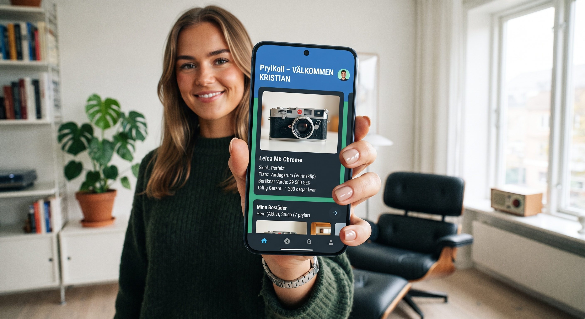

# 🏠 BoValvet

**BoValvet** är en mobilanpassad webbapplikation för digital heminventering, garanti- och kvittohantering samt säkring av hemmets lösöresvärde. Applikationen är utformad för vanliga bostadsrätts- och villaägare med fokus på trygghet, enkelhet och noll tekniskt krångel.

---

## 🎯 Vision & Syfte

De flesta hemägare är omedvetet underförsäkrade och har svårt att uppskatta det sammanlagda värdet på sitt lösöre förrän en olycka är framme. BoValvet löser detta genom:

1. **Snabb inventering:** Fota ett enskilt föremål eller ett helt rum – AI identifierar märke, modell, kategori och uppskattar både nypris och begagnatvärde.
2. **Kvitto- & Garantivakt:** Tolka kvitton med bildigenkänning/OCR. Håller koll på svensk konsumenträtt (3 års lagstadgad reklamationsrätt) och förlängda garantier med tydliga påminnelser.
3. **Akut skadeunderlag:** Vid inbrott, brand eller vattenskada genereras ett juridiskt formaterat skadeunderlag som PDF direkt till försäkringsbolagets skadereglerare, komplett med foton, delsummor och kvitton.
4. **Säljhjälp (Återbruk):** När det är dags att rensa skapar appen optimerade säljtexter och prisförslag med ett klick för Blocket, Facebook Marketplace och Tradera.

---

## ✨ Huvudfunktioner

* 📷 **AI-kameraskanning:** Fota med mobilkameran för automatisk identifiering av föremål, märken, modeller och värdeberäkningar via Google Gemini.
* 👗 **Garderober & Egna rum:** Stöd för alla hemmets ytor inklusive Garderob samt möjlighet att skapa egna anpassade rum (t.ex. Vinkällare, Garage, Balkong) med automatisk emoji-igenkänning.
* 🛡️ **Kvitto- & Garantivakten:** Koppla kvitton direkt till föremål. Färgkodade trafikljus visar aktiva garantier och varnar innan reklamationsrätten löper ut.
* 📄 **Det Skarpa Skadepaketet:** Skapa ett formellt skadeunderlag (PDF) med sammanställning, kvitton, föremålsförteckning och signaturrad vid skadehändelser.
* 📊 **Enkelt Exportcenter:** Exportera hela hemvalvet till antingen en **Färdig PDF-rapport** eller ett **Kalkylark (Excel / Numbers)**, automatiskt grupperat och sorterat per rum.
* 🔒 **Lokal bildsäkring:** All känslig EXIF- och GPS-metadata tvättas lokalt i webbläsaren innan bilderna laddas upp till molnet. Bilderna skalas dessutom till optimal skärpa.
* 🛒 **Säljannonsgenerator:** AI-genererade rubriker, beskrivningar och prissättningsstrategier anpassade för populära marknadsplatser.

---

## 👥 UX & Språkregler

Gränssnittet i BoValvet riktar sig till slutanvändare utan teknikintresse. Följande principer gäller konsekvent:

* **Föremål framför allt:** Använd alltid ordet *"föremål"* (inte "prylar", "saker" eller "objekt").
* **Inventerade enheter:** Räknare formuleras alltid som *"inventerade"* (exempelvis: *12 föremål inventerade*).
* **Ingen IT-jargong i UI:** Undvik tekniska termer som JSON, EXIF, UTF-8 BOM etc. Använd begripliga uttryck som *"Lokal bildsäkring"*, *"Färdig PDF-rapport"* och *"Kalkylark (Excel / Numbers)"*.

---

## 🛠️ Teknisk Arkitektur

* **Frontend:** [Next.js](https://nextjs.org/) (App Router, React 19, TypeScript)
* **Styling:** [Tailwind CSS v4](https://tailwindcss.com/) & [Lucide React](https://lucide.dev/)
* **Backend & Databas:** [Supabase](https://supabase.com/) (PostgreSQL, Supabase Auth med OAuth/e-post, Supabase Storage med privat bucket `item-photos` och tidsbegränsade signed URLs)
* **AI & Datorseende:** Google Gemini API (`@google/genai`, modellen `gemini-3.8-flash`)
* **Dokumentgenerering:** [jsPDF](https://github.com/parallax/jsPDF) & [jspdf-autotable](https://github.com/simonbengtsson/jsPDF-AutoTable)
* **Hosting:** Vercel (kopplat till repot `Kmatiq/bovalvet` på branch `main`)

---

## 📁 Projektstruktur

```text
├── app/
│   ├── actions/                  # Server Actions (bl.a. Gemini-bildanalys)
│   ├── api/                      # Next.js API Routes
│   │   ├── analyze/              # AI-analys av föremål och bounding boxes
│   │   ├── analyze-receipt/      # Kvitto-OCR och garantiberäkning
│   │   └── generate-listing/     # Annonstexter för Blocket/Tradera/Marketplace
│   ├── globals.css               # Global styling och design-tokens
│   ├── layout.tsx                # Rot-layout och metadata
│   ├── page.tsx                  # BoValvets huvudapplikation och mobilskal
│   └── DESIGN.md                 # UI/UX- och typografiregler
├── DOKUMENTATION.md              # Fullständig projektdokumentation, historik och teknisk analys
├── ROADMAP.md                    # Handlingsplan och status
├── lib/
│   ├── exportVault.ts            # PDF- och Excel/Numbers-export (grupperat per rum)
│   ├── sanitizeImage.ts          # Klientsidig EXIF-rensning och bildoptimering
│   └── supabaseClient.ts         # Supabase-klientinitialisering
├── public/                       # Statiska ikoner, PWA-resurser och bilder
└── README.md
```

---

## 🚀 Kom igång för utveckling

### 1. Klona repositoriet
```bash
git clone https://github.com/Kmatiq/bovalvet.git
cd bovalvet
```

### 2. Installera beroenden
```bash
npm install
```

### 3. Konfigurera miljövariabler
Kopiera mallen `.env.example` till `.env.local`:
```bash
cp .env.example .env.local
```

Fyll i dina nycklar i `.env.local`:
```env
GEMINI_API_KEY=din_gemini_api_nyckel
NEXT_PUBLIC_SUPABASE_URL=https://ditt-projekt.supabase.co
NEXT_PUBLIC_SUPABASE_ANON_KEY=din_supabase_anon_nyckel
```

### 4. Starta utvecklingsservern
```bash
npm run dev
```

> **Tips för Windows:**  
> Om du stöter på WebSocket-problem i dev-läge (`ws://127.0.0.1:3000/_next/hmr failed`), starta med:
> ```bash
> npx next dev -H 127.0.0.1 --webpack
> ```
> Alternativt verifiera via produktionsbygget:
> ```bash
> npm run build && npm run start
> ```

---

## 📜 Skript

* `npm run dev` – Startar lokal utvecklingsserver
* `npm run build` – Bygger applikationen för produktion
* `npm run start` – Startar produktionsservern
* `npm run lint` – Kör Next.js ESLint-kontroller

---

## 🔒 Säkerhet & Integritet

* **Bilder & Kvitton:** Sparas i Supabase Storage i privata buckets (`item-photos`). Användare når endast sina egna filer genom tidsbegränsade, signerade webbadresser.
* **Metadata & GPS:** Inga positioner eller kameradata lämnar användarens enhet tack vare klientsidig bildsäkring i HTML5 Canvas innan uppladdning.

